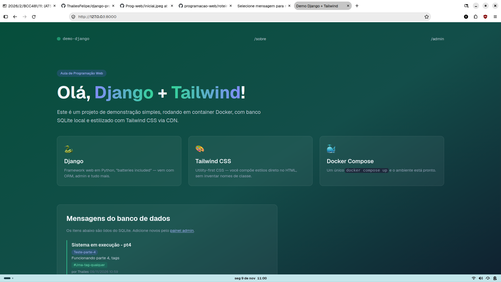

# 3ª entrega de Django - Prog. WEB (21/10/2026)

- Nome: Thalles Felipe Rodrigues de Almeida Santos
- Curso: Ciência da Computação
- Disciplina de Programação WEB - BCC-481

# Sistema em execução:



# Guia para execução

**Fedora — rodando local (venv):**

```bash
cd /home/thalles/Documentos/django-progweb

python3 -m venv .venv
source .venv/bin/activate
pip install -r requirements.txt

python manage.py migrate
python manage.py runserver
```

Depois abra `http://127.0.0.1:8000/`.

**Nas próximas vezes** (venv já criado):

```bash
cd /home/thalles/Documentos/django-progweb
source .venv/bin/activate
python manage.py runserver
```

**Opcional — criar admin:**

```bash
DJANGO_SUPERUSER_PASSWORD=admin python manage.py createsuperuser --noinput --username admin --email admin@example.com
```

**Parar o servidor:** `Ctrl+C`.

**Com Podman** (o projeto tem `Dockerfile` + `docker-compose.yml`):

```bash
cd /home/thalles/Documentos/django-progweb
podman compose up --build
```

Se o comando acima reclamar que falta o provider, instale antes:

```bash
sudo dnf install podman-compose
podman-compose up --build
```

Acesse também em `http://127.0.0.1:8000/`.
